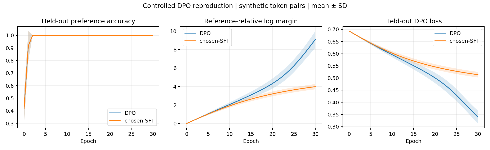

# DPO 核心算法复现 | CPU mini experiment

论文：Rafailov et al., Direct Preference Optimization: Your Language Model is Secretly a Reward Model, NeurIPS 2023. https://arxiv.org/abs/2305.18290
原作者代码：https://github.com/eric-mitchell/direct-preference-optimization

## 快速开始
需要 Python 3.10+、PyTorch、Matplotlib；无需 GPU、模型下载或 API 密钥。首次安装依赖需要网络。

```bash
python -m venv .venv
# Linux/macOS: source .venv/bin/activate
# Windows PowerShell: .venv\Scripts\Activate.ps1
python -m pip install -r requirements.txt
python -m unittest discover -s tests -v
python train.py
python train.py --beta 0.5 --out results/beta05
```

## 文件结构
- `train.py`：数据构造、GRU 自回归模型、DPO 损失、训练、评估、绘图。
- `tests/test_core.py`：初始损失、梯度方向、数据隔离、输出形状测试。
- `results/`：实际运行的 CSV、JSON、日志、曲线；beta05 为敏感性实验。
- `REPORT.md`：详细复现报告。
- `.github/workflows/ci.yml`：上传 GitHub 后自动执行测试与短训练（尚未在 GitHub 上运行）。

## 方法
DPO 论文式 (7)：`-logsigmoid(beta * ((logp_w-logp_l)-(ref_w-ref_l)))`。只累加回答 token 的对数概率，参考模型冻结，训练前缓存其概率。使用稳定的 logsigmoid。对照组从同一参考模型出发，只对 chosen 回答做 SFT。

## 实际结果
三随机种子平均，30 epoch，beta=0.1。测试偏好准确率 41.67% → 100%；DPO loss 0.6931 → 0.3392；相对参考模型的 log margin 0 → 9.0992。chosen-SFT 同样达到 100%，相对 margin 3.9871。不能据此断言 DPO 在真实语言任务上优于 SFT。



## GitHub 发布
在 GitHub 新建空仓库（不要预先添加 README），在项目目录运行：

```bash
git init
git add .
git commit -m "Reproduce DPO core objective"
git branch -M main
git remote add origin https://github.com/YOUR_USERNAME/YOUR_REPO.git
git push -u origin main
```

替换用户名和仓库名；需要自己的 GitHub 登录权限。也可以在网页选择 Add file → Upload files，注意包含隐藏的 .github 目录。当前交付未上传远端。

## 范围与限制
合成 token 偏好任务，16 个 prompt 组合（12 训练、4 测试），所有 prompt 的偏好规则相同；因此任务很容易，不能验证自然语言能力、真实人类偏好或论文 benchmark 数值。这里复现的是目标函数与优化机制，而非完整论文实验。图是实际程序输出，不是终端截图。依赖范围未锁定全部传递依赖，跨平台数值可能略有差异。
